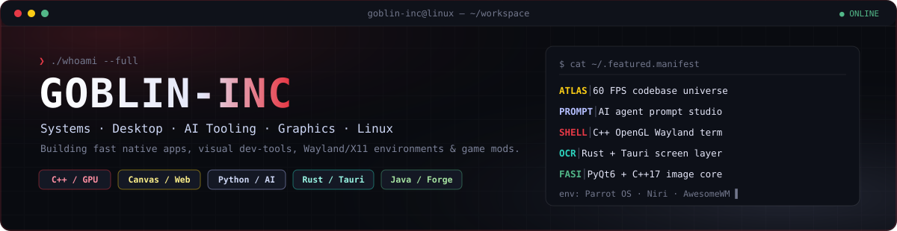

<p align="center">
  
</p>

<p align="center">
  <a href="https://goblin-inc.github.io/"></a>
  <a href="https://goblin-inc.github.io/Project-Atlas/"></a>
  <a href="https://t.me/FxtTUNE"></a>
  <a href="mailto:onosov.ferg@gmail.com"></a>
  <a href="README_Ru.md"></a>
</p>

---

### `01 //` Selected Works — Across Domains

| Domain | Project | Stack | Highlights |
| :--- | :--- | :--- | :--- |
| **`WEB · CANVAS`** | [**Project Atlas**](https://github.com/Goblin-Inc/Project-Atlas) · [Live Demo](https://goblin-inc.github.io/Project-Atlas/) | `JS` · `HTML5 Canvas` · `Python` | Interactive 60 FPS constellation map of any local folder or GitHub repo: golden dependency rays, 4 lenses (Blast Radius, Health, Route), `Ctrl+K` teleport & vector SVG export |
| **`AI · DEVTOOLS`** | [**PromptForge**](https://github.com/Goblin-Inc/PromptForge) | `Python` · `LLM Tooling` | System prompt studio & one-click skill auto-deployer for Ollama, Claude Code, Antigravity, Codex & Cursor |
| **`C++ · GPU`** | [**Gob-Inc-shell**](https://github.com/Goblin-Inc/Gob-Inc-shell) | `C++17` · `GLFW 3.4` · `OpenGL` | Custom hardware-accelerated terminal emulator (`v2.0.0`) with native Wayland & X11 support |
| **`RUST · OCR`** | [**Screen Overlay Translator**](https://github.com/Goblin-Inc/screen-overlay-translator) | `Rust` · `Tauri v2` · `Tesseract` | Ultra-fast live screen OCR & AI translation overlay rendered directly over games, manga & desktop apps |
| **`NATIVE · UI`** | [**FaSI**](https://github.com/Goblin-Inc/FaSI) | `Python` · `PyQt6` · `C++17` | Instant `Alt+Space` desktop overlay for searching, previewing & copying images powered by a native `libfasi_core.so` engine |
| **`BROWSER`** | [**SlateBrow**](https://github.com/Goblin-Inc/SlateBrow) | `Python` · `PySide6` · `QtWebEngine` | Minimalist Dark Slate web browser with hardware video decoding (`H.264/AAC`), Cinema Mode & persistent sessions |
| **`RETRO · AI`** | [**Aski-Online**](https://github.com/Goblin-Inc/Aski-Online) | `Python` · `AI` | Nostalgic early-2000s ICQ / WinXP AI messenger with custom personas and long-term conversation memory |
| **`GAMEDEV`** | [**RtCoD Mods**](https://github.com/RtCoD-Stuff) | `Java` · `Forge 1.20.1` | Full Minecraft RPG ecosystem: 20 races with real 3D model/hitbox scaling, classes, blessings & server-side donate GUI |

---

### `02 //` Core Stack & Focus

```text
├── Systems & Native   C++17 · Rust · GLFW/OpenGL · shared libraries (.so) · POSIX/PTY
├── Web & Visuals      Vanilla ES Modules · HTML5 Canvas 2D · SVG · Static Code Analysis
├── Desktop & AI       Python 3 · PyQt6/PySide6 · Tauri v2 · AI Agent Workflows · OCR
└── Linux & Craft      Parrot OS · Niri (Wayland) · AwesomeWM (Lua) · CLI & Net Tooling
```

---

<p align="center">
  <sub><code>// shipping practical tools, breaking Linux environments, and building things people actually want to click.</code></sub>
</p>
