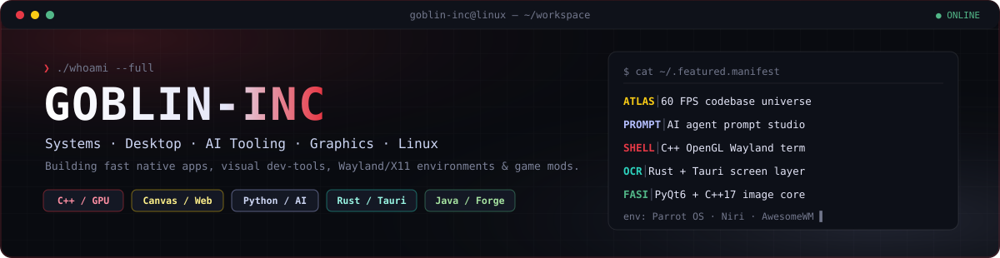
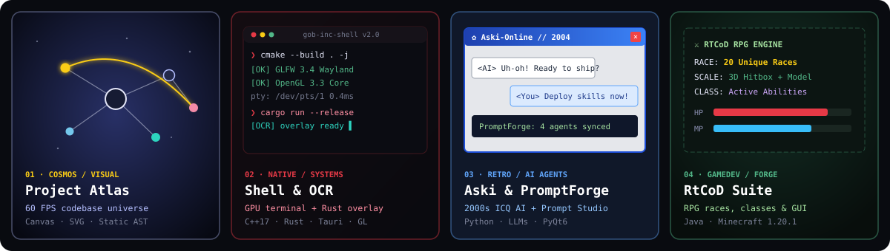

<p align="center">
  
</p>

<p align="center">
  <a href="https://goblin-inc.github.io/"></a>
  <a href="https://goblin-inc.github.io/Project-Atlas/"></a>
  <a href="https://t.me/FxtTUNE"></a>
  <a href="mailto:onosov.ferg@gmail.com"></a>
  <a href="README.md"></a>
</p>

---

### `01 //` Избранные проекты — разные направления

| Направление | Проект | Стек | Что внутри |
| :--- | :--- | :--- | :--- |
| **`WEB · CANVAS`** | [**Project Atlas**](https://github.com/Goblin-Inc/Project-Atlas) · [Живая демка](https://goblin-inc.github.io/Project-Atlas/) | `JS` · `HTML5 Canvas` · `Python` | Интерактивная 60 FPS вселенная кода для локальных папок и GitHub-репо: золотые лучи зависимостей, 4 линзы (Blast Radius, Здоровье, Маршрут), `Ctrl+K` телепорт и экспорт SVG |
| **`AI · DEVTOOLS`** | [**PromptForge**](https://github.com/Goblin-Inc/PromptForge) | `Python` · `LLM Tooling` | Студия системных промптов и авто-деплоер скиллов в 1 клик для Ollama, Claude Code, Antigravity, Codex и Cursor |
| **`C++ · GPU`** | [**Gob-Inc-shell**](https://github.com/Goblin-Inc/Gob-Inc-shell) | `C++17` · `GLFW 3.4` · `OpenGL` | Собственный GPU-ускоренный эмулятор терминала (`v2.0.0`) с нативной поддержкой Wayland и X11 |
| **`RUST · OCR`** | [**Screen Overlay Translator**](https://github.com/Goblin-Inc/screen-overlay-translator) | `Rust` · `Tauri v2` · `Tesseract` | Сверхбыстрый экранный OCR + AI-переводчик поверх игр, манги и любых десктоп-приложений |
| **`NATIVE · UI`** | [**FaSI**](https://github.com/Goblin-Inc/FaSI) | `Python` · `PyQt6` · `C++17` | Мгновенный `Alt+Space` оверлей поиска и копирования изображений на базе нативного C++ ядра `libfasi_core.so` |
| **`BROWSER`** | [**SlateBrow**](https://github.com/Goblin-Inc/SlateBrow) | `Python` · `PySide6` · `QtWebEngine` | Минималистичный тёмный браузер с аппаратным декодированием (`H.264/AAC`), Cinema Mode и сохранением сессий |
| **`RETRO · AI`** | [**Aski-Online**](https://github.com/Goblin-Inc/Aski-Online) | `Python` · `AI` | Ностальгический AI-мессенджер в эстетике ICQ / WinXP 2000-х с кастомными персонами и долгой памятью |
| **`GAMEDEV`** | [**RtCoD Mods**](https://github.com/RtCoD-Stuff) | `Java` · `Forge 1.20.1` | RPG-экосистема для Minecraft: 20 рас с реальным 3D-скейлингом моделей и хитбоксов, классы, благословения и серверный GUI |

---

### `02 //` Разные миры — разные стили
> Каждый проект получает собственный визуальный язык: от 60 FPS космических графов и C++ Wayland-терминалов до ретро-ICQ 2000-х и RPG-механик.

<p align="center">
  
</p>

---

### `03 //` Основной стек и фокус

<p align="center">
  
  
  
  
  
  
  
</p>

```text
├── Системка и Натив   C++17 · Rust · GLFW/OpenGL · shared-библиотеки (.so) · POSIX/PTY
├── Веб и Визуал       Vanilla ES Modules · HTML5 Canvas 2D · SVG · Статический анализ кода
├── Десктоп и AI       Python 3 · PyQt6/PySide6 · Tauri v2 · AI-агенты · OCR
└── Linux и Среда      Parrot OS · Niri (Wayland) · AwesomeWM (Lua) · CLI и сетевые тулзы
```

---

<p align="center">
  <sub><code>// делаю быстрые утилиты, собираю свои Linux-среды и выпускаю инструменты, которыми реально хочется пользоваться.</code></sub>
</p>
